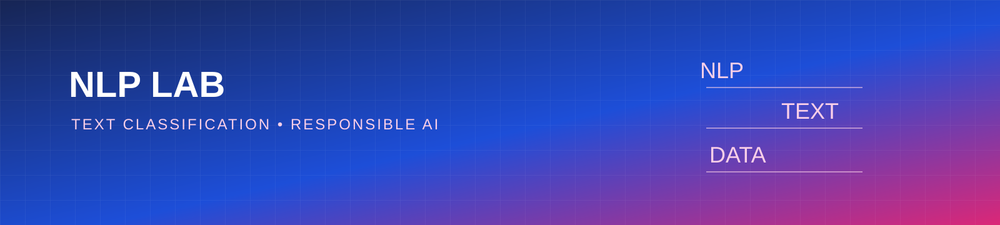

<p align="center"></p>

# NLP Text Classification

A clean starter project for Natural Language Processing (NLP), text classification, and sentiment analysis with Python.

## Learning goals

- Normalize and inspect text data
- Build a transparent baseline classifier
- Separate training, validation, and test data
- Report precision, recall, F1-score, and limitations
- Avoid overstating model confidence

## Quick start

```bash
python -m venv .venv
source .venv/bin/activate  # Windows: .venv\\Scripts\\activate
pip install -r requirements.txt
python src/baseline.py
pytest -q
```

## Roadmap

- [ ] Add a labeled sample dataset with a clear license
- [ ] Add TF-IDF and logistic regression baseline
- [ ] Add confusion-matrix reporting
- [ ] Compare multilingual tokenization approaches
- [ ] Add error analysis examples

## Data and ethics

Use datasets with documented licenses and remove personal or sensitive information. Do not use a text classifier for employment, medical, legal, or other high-impact decisions without domain review and strong validation.

## License

MIT License. See [LICENSE](LICENSE).
